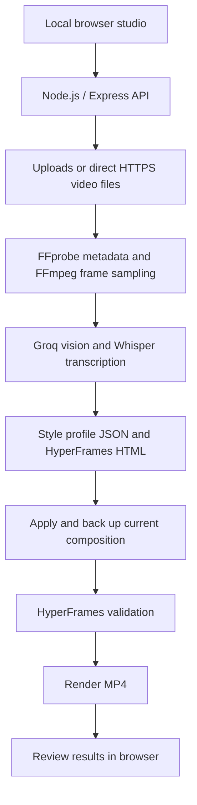

<div align="center">

# 🎬 Video Editor

### AI-Powered Reference Video Style Studio

Analyze a reference video and turn your own footage into an editable **HyperFrames composition** with captions, timed segments, and punch-in motion.

[](LICENSE)
[](https://nodejs.org/)
[](https://developer.mozilla.org/en-US/docs/Web/JavaScript)
[](https://ffmpeg.org/)

</div>

Provide a reference video and your source footage to analyze their style, apply a composition, and render an MP4 locally. Processing starts automatically when both inputs are supplied; the results include the style profile and generated files for review.

## 📑 Table of Contents

- [Features](#-features)
- [System Architecture](#-system-architecture)
- [Tech Stack](#-tech-stack)
- [Project Structure](#-project-structure)
- [Getting Started](#-getting-started)
- [Environment Variables](#-environment-variables)
- [Development Commands](#-development-commands)
- [API Processing Flow](#-api-processing-flow)
- [Known Limitations](#-known-limitations)
- [Contributing](#-contributing)
- [License](#-license)
- [Support](#-support)
- [Author](#-author)

## ✨ Features

- Upload reference and source videos, or supply direct public HTTPS video-file URLs.
- Inspect video metadata with FFprobe and sample reference frames with FFmpeg.
- Generate structured style profiles using Groq vision, including pace, palette, captions, and motion suggestions.
- Attempt Groq Whisper transcription for caption generation.
- Generate HTML compositions with timed video segments, captions, punch-ins, and source audio.
- Review generated analysis and composition files, and reapply an edit when needed.
- Back up the current composition, validate changes, and render an MP4 when applying an edit.
- Restore the previous composition automatically if validation or rendering fails.

## 🏗️ System Architecture



## ⚙️ Tech Stack

| Layer | Technologies |
| --- | --- |
| Studio | HTML, CSS, JavaScript |
| Backend | Node.js ES modules, Express, Multer, dotenv |
| AI | Groq SDK, vision analysis, Whisper transcription |
| Media processing | FFmpeg, FFprobe |
| Composition and rendering | HyperFrames CLI pinned to 0.8.186, GSAP |
| Tests | Node.js test runner |

## 📂 Project Structure

```text
video-editor/
├── LICENSE
├── README.md
└── my-video/
    ├── .env.example          # Configuration template
    ├── .studio/             # Browser studio interface
    ├── .generated/          # Generated HTML and analysis JSON
    ├── backups/             # Previous compositions and render copies
    ├── renders/             # Exported videos
    ├── tests/               # Generator and lint-scan tests
    ├── lib/                 # Apply workflow, URL safety, and profile validation
    ├── uploads/             # Reference and source media
    ├── AI-REFERENCE-STYLE.md # Additional workflow notes
    ├── hyperframes.json     # HyperFrames configuration
    ├── index.html           # Active composition
    ├── meta.json            # Project metadata
    ├── package.json         # Dependencies and commands
    └── server.mjs           # Local studio API and generation logic
```

The server creates its working directories as needed. Generated HTML lives in `.generated/`, and composition backups use `.html.bak` filenames so HyperFrames does not scan them as active compositions.

## 🚀 Getting Started

Install Node.js 22 or newer with npm, FFmpeg, and FFprobe. You also need a Groq API key with access to the configured vision and transcription models. The commands below use PowerShell.

```powershell
git clone https://github.com/marianodags/video-editor.git
cd video-editor/my-video
npm install
Copy-Item .env.example .env
```

For an existing checkout, run the copy command only if `.env` does not already exist. Edit `.env` and add your `GROQ_API_KEY`. Keep this file private; it is excluded by `.gitignore`.

Verify that the media tools are available:

```powershell
node --version
npm --version
ffmpeg -version
ffprobe -version
```

If FFmpeg or FFprobe is unavailable on `PATH`, set their full executable paths in `.env`.

Start the studio from `my-video/`:

```powershell
npm run studio
```

Open [http://127.0.0.1:4173](http://127.0.0.1:4173). Supply a reference video and your footage; the studio automatically analyzes, applies, validates, and renders the edit. Successful exports are saved in `my-video/renders/`.

## 🔐 Environment Variables

Use [my-video/.env.example](my-video/.env.example) as the template for `my-video/.env`.

| Variable | Default | Purpose |
| --- | --- | --- |
| `GROQ_API_KEY` | Empty | Required for AI analysis and transcription. |
| `GROQ_VISION_MODEL` | `qwen/qwen3.8-27b` | Vision model used to analyze reference frames. |
| `GROQ_TRANSCRIPTION_MODEL` | `whisper-large-v3-turbo` | Speech transcription model. |
| `PORT` | `4173` | Local studio server port. |
| `MAX_VIDEO_BYTES` | `209715200` | Maximum size per uploaded or downloaded video: 200 MiB. |
| `FFMPEG_PATH` | Empty; uses `ffmpeg` | Optional full path to the FFmpeg executable. |
| `FFPROBE_PATH` | Empty; uses `ffprobe` | Optional full path to the FFprobe executable. |

## 💻 Development Commands

Run these commands from `my-video/`:

| Command | Purpose |
| --- | --- |
| `npm run studio` | Start the local reference-style studio and API. |
| `npm run dev` | Open the HyperFrames composition preview. |
| `npm run check` | Validate the active HyperFrames composition. |
| `npm run render` | Render the active composition to MP4. |
| `npm test` | Run generator and lint-scan hygiene tests. |
| `npm run publish` | Publish the composition through HyperFrames. |

After editing a composition, run `npm run check` and inspect its preview before rendering or publishing. The pinned CLI is invoked through `npx`, which may download it on first use.

## 📡 API Processing Flow

| Endpoint | Behavior |
| --- | --- |
| `GET /api/health` | Report Groq configuration, FFmpeg/FFprobe availability, and upload limit. |
| `POST /api/analyze` | Accept multipart fields `referenceVideo` and `sourceVideo`, or `referenceUrl` and `sourceUrl`; return analysis and generated file URLs. |
| `POST /api/apply` | Accept JSON containing an analysis `id`; back up and replace `index.html`, validate, and render. Restore the previous composition if validation or rendering fails. |

Analysis reads both videos' metadata, samples three reference frames, attempts transcription, requests a style profile, and writes analysis JSON and composition HTML. Applying an edit also copies existing renders into a timestamped backup directory before rendering the new output.

## ⚠️ Known Limitations

- URLs must point directly to public HTTPS video files. YouTube and other social watch-page URLs are unsupported; upload a downloaded video you have permission to use.
- Style analysis uses only three sampled reference frames and may miss cuts, transitions, and audio details.
- The generator applies selected profile properties; it does not reproduce every suggested effect or guarantee an exact style match.
- Transcription is skipped for files over 24 MiB and falls back to an empty transcript on failure. Review generated captions and timings.
- Long transcript segments are split into groups of up to six words. Timing within those segments is estimated from word counts; fast speech can still trigger caption-readability warnings.
- The generator segments the source footage; it does not detect viral highlights or automatically select the best moments.
- AI operations require network access and access to the configured Groq models. Submitted frames and video files used for transcription are sent to Groq.
- The studio binds to `127.0.0.1` for local use. Uploads, generated files, and backups remain on disk and may require manual cleanup.

## 🤝 Contributing

Bug reports, feature requests, and contributions are welcome.

1. Fork the repository and create a feature branch.
2. Make your changes and run `npm test` from `my-video/`.
3. For composition changes, run `npm run check` and review the preview.
4. Open a pull request describing the change and how you verified it.

## 📄 License

This project is licensed under the [MIT License](LICENSE).

Copyright (c) 2026 Mariano Q. Daga-ang Jr.

## 🌟 Support

If this project is useful to you, consider starring the repository to help others discover it.

## 👤 Author

Built by **Mariano Q. Daga-ang Jr.**

- GitHub: [@mardags](https://github.com/mardags)
- LinkedIn: [Mar Dags](https://www.linkedin.com/in/mariano-q-daga-ang-jr-566185286/)
